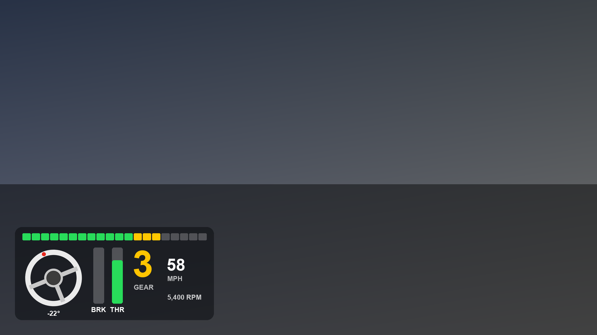
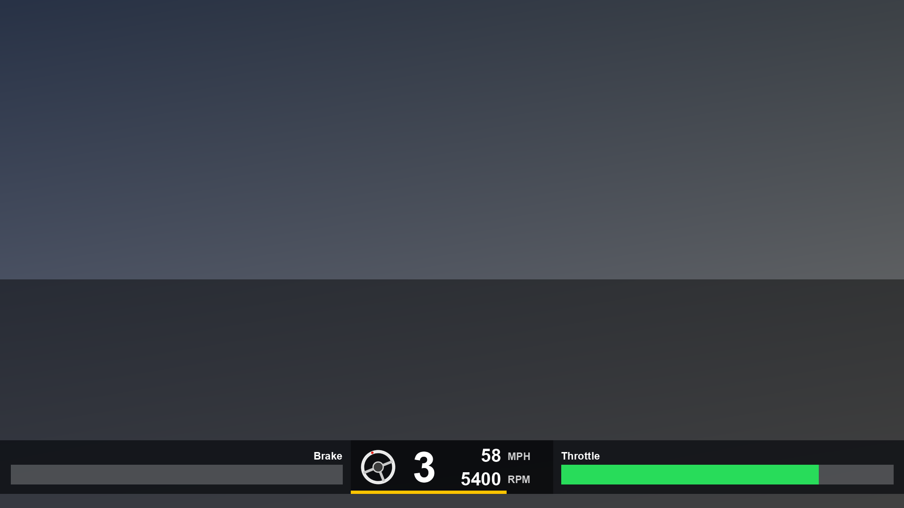
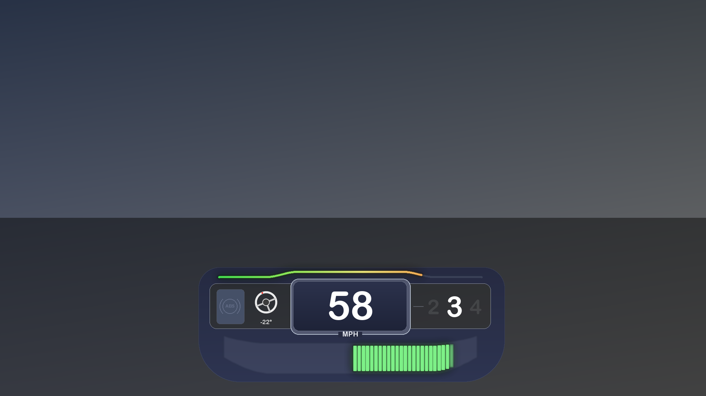
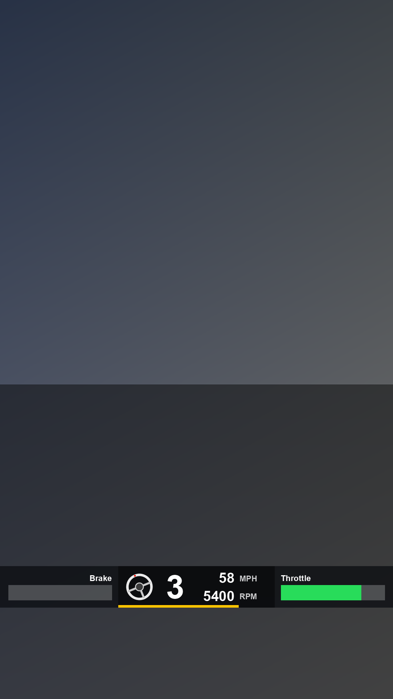

# Mazda3 HUD Telemetry

Arduino + Python tools for reading real-time driving data (RPM, speed,
throttle, brake, steering angle, gear) straight off a 2013 Mazdaspeed3's
CAN bus with a $10 MCP2515 module -- no paid scan tool, no dealer
software. Built for recording driving data and turning it into a
transparent video overlay (throttle/brake bars, a rotating steering
wheel, gear indicator) to drop onto dash-cam or track-day footage.

**I (the repo owner) take zero credit for the code itself -- this whole
project, every script and every Arduino sketch in this repo, was written
by [Claude](https://claude.com) (Anthropic's AI) through a series of
conversations where I described what I wanted and we tested it together
against my actual car. I'm sharing it in case it's useful to anyone else
with the same car, or as a reference for reverse-engineering CAN buses
on other cars.**

## ⚠️ Read before using

- Confirmed working on a **2013 Mazdaspeed3 (BL platform, 6-speed
  manual)**. Likely works unchanged on other 2010-2013 BL-platform
  Mazda3/Mazdaspeed3 cars. **Not tested on anything else.** Verify every
  signal against something you can see with your own eyes before
  trusting it -- especially anything you'd rely on while driving.
- This toolkit only **listens** to the CAN bus -- nothing in it
  transmits control messages onto the bus.
- You are wiring a hobby electronics board directly to your car's data
  network. Double-check your connections before plugging into a running
  car. If you're not comfortable with that, don't do it.
- This is a hobby reverse-engineering project, not an official Mazda
  product, and isn't affiliated with Mazda Motor Corporation in any way.

## What's in here

```
firmware/        Arduino sketches (flash ONE of these at a time)
tools/           Python scripts that talk to the Arduino over serial
hud_overlay/     Turns a recorded drive into a transparent overlay video
scripts/         Double-click Windows tools -- no typing required
docs/            Setup guide, confirmed signal reference, GitHub guide
examples/        A real (short) sample drive log to test the renderer with
```

## Easiest way to use this (Windows, no typing)

If you're on Windows and don't want to type any commands, double-click
these in the [`scripts/`](scripts/) folder instead:

| Double-click this | What it does |
|---|---|
| `watch_live.bat` | Connects to the Arduino and shows live data on screen -- good for checking your wiring before you drive. Nothing is saved. |
| `start_logging.bat` | Connects to the Arduino and records your drive to a timestamped CSV in a new `recordings/` folder. Press Ctrl+C in the window when you're done driving. |
| `render_video.bat` | Picks a recording from `recordings/` (or any CSV you point it at) and turns it into a transparent overlay video, horizontal or vertical. |

Each one finds the Arduino's COM port automatically, or asks you to pick
it if there's more than one device plugged in. You still need to have
flashed `firmware/can_live/can_live.ino` first and run
`pip install -r requirements.txt` once (see
[`docs/HARDWARE_SETUP.md`](docs/HARDWARE_SETUP.md)) -- the scripts will
tell you if something's missing.

## Doing it from the command line instead

The scripts above are just thin wrappers around these -- use them
directly if you'd rather type commands or you're not on Windows.

## The tools, at a glance

| I want to... | Flash this firmware | Run this |
|---|---|---|
| Find NEW, unmapped signals on my own car | `firmware/can_discovery/can_discovery.ino` | `python tools/discover_ids.py --port COM6` |
| Watch everything this toolkit already knows, live | `firmware/can_live/can_live.ino` | `python tools/live_dashboard.py --port COM6` |
| Record a drive to a CSV file | `firmware/can_live/can_live.ino` | `python tools/record_drive.py --port COM6 --out my_drive.csv` |
| Turn a recorded CSV into an overlay video | *(no Arduino needed)* | `python hud_overlay/render_overlay.py --csv my_drive.csv --config hud_overlay/configs/horizontal_1080p.json --out my_drive_hud.mov` |

Only one firmware can be on the Arduino at a time -- re-flash it with
the Arduino IDE when you want to switch tools. See
[`docs/HARDWARE_SETUP.md`](docs/HARDWARE_SETUP.md) for wiring, library
installation, and how to flash a sketch.

Every Python script supports `--help` for the full list of options, and
`--port` defaults to `COM6` (Windows) -- pass your own if yours is
different (see "Finding your serial port" in the hardware guide).

## Quick start

```bash
# 1. Install Python dependencies
pip install -r requirements.txt

# 2. Flash firmware/can_live/can_live.ino to your Arduino (see docs/HARDWARE_SETUP.md)

# 3. Record a drive (Ctrl+C when you're done driving)
python tools/record_drive.py --port COM6 --rate 20 --out my_drive.csv

# 4. Render it as a transparent overlay video (needs ffmpeg on PATH)
python hud_overlay/render_overlay.py \
    --csv my_drive.csv \
    --config hud_overlay/configs/horizontal_1080p.json \
    --out my_drive_hud.mov

# Drop my_drive_hud.mov on a track above your dash-cam footage in
# Premiere (or any editor that supports alpha-channel video)
```

Want to try the renderer right now without any hardware? There's a real
sample recording included:

```bash
python hud_overlay/render_overlay.py \
    --csv examples/sample_drive_log.csv \
    --config hud_overlay/configs/horizontal_1080p.json \
    --out sample_hud.mov
```

### Digital cluster style

A game-style cluster: gradient RPM line that blinks at the 6500 RPM rev
limiter, an ABS lamp and steering wheel on the left, MPH in the middle,
gear on the right, and a curved band of brake (red) / throttle (green)
segments below.

The ABS lamp lights when a front wheel locks up: while you're off the
throttle and above 10 mph, a front wheel turning 25% slower than the fastest
wheel counts. Rear lockups (handbrake turns) are ignored on purpose; the rears
still count toward the reference speed, so locking both fronts is caught.
It needs the `wheel_fl,wheel_fr,wheel_rl,wheel_rr` columns, which
`tools/record_drive.py` now logs (older recordings just leave the lamp off).
Thresholds are in the `abs` section of the config.

```bash
python hud_overlay/render_overlay.py \
    --csv my_drive.csv \
    --config hud_overlay/configs/cluster_1080p.json \
    --out my_drive_hud_cluster.mov
```


### Vertical video (Instagram Reels/Stories)

```bash
python hud_overlay/render_overlay.py \
    --csv my_drive.csv \
    --config hud_overlay/configs/vertical_reels.json \
    --width 1080 --height 1920 \
    --out my_drive_hud_vertical.mov
```

## What each overlay looks like

One preview frame per config in `hud_overlay/configs/` (same data in each:
58 mph, 3rd gear, 5,400 RPM, 62% throttle, wheel turned 22° left), so you
can pick one before rendering a whole video.

| `panel_default.json` | `horizontal_1080p.json` |
|---|---|
|  |  |
| **`cluster_1080p.json`** | **`vertical_reels.json`** (1080x1920) |
|  |  |

To preview your own drive with any config, render a single frame:

```bash
python hud_overlay/render_overlay.py --csv my_drive.csv \
    --config hud_overlay/configs/cluster_1080p.json \
    --preview 12.5 --preview-out frame.png
```

## How the signals were found

See [`docs/FINDINGS.md`](docs/FINDINGS.md) for the full reference: every
CAN ID, byte offset, and formula this toolkit decodes, how each one was
confirmed, and a couple of dead ends that are worth knowing about if you
go exploring further with `discover_ids.py`.

## License

MIT -- see [`LICENSE`](LICENSE). Use it, modify it, share it, just keep
the copyright notice.
